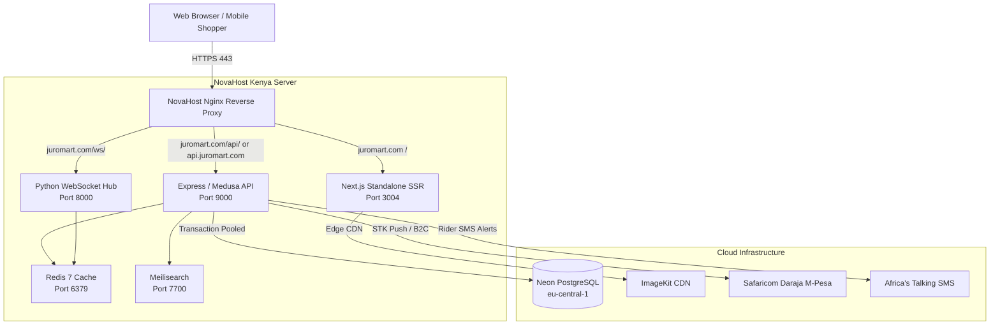

# JuroMart Production Deployment & Infrastructure Guide
**Platform Domain:** [juromart.com](https://juromart.com) | [api.juromart.com](https://api.juromart.com)  
**Hosting Provider:** NovaHost Kenya ([novahost.co.ke](https://novahost.co.ke/))  
**Architecture:** Next.js 16 (Standalone SSR) + Express/Medusa Backend + Python WebSocket Hub + Neon PostgreSQL + Redis + Nginx Reverse Proxy

---

## 1. System Architecture Overview



---

## 2. DNS Zone Wiring at NovaHost Kenya (novahost.co.ke)

Your NovaHost nameservers are:
* `ns1.novacloud.co.ke`
* `ns2.novacloud.co.ke`
Your allocated server IP is **`213.139.204.9`**.

### Current Status from your NovaHost DNS Management Screen:
* **Line 12**: `juromart.com` | `A` | `14400` | `213.139.204.9` &rarr; ✅ **Active**
* **Line 15**: `www.juromart.com` | `CNAME` | `14400` | `juromart.com` &rarr; ✅ **Active**

### Required Records to Add:
Click the green **`+ Add Record`** button in NovaHost DNS Management to add the following:

| Action | Name | Type | TTL | Value | Purpose |
|---|---|---|---|---|---|
| **Add** | `api.juromart.com` (or `api`) | **A** | `14400` | `213.139.204.9` | Backend REST API & M-Pesa Callbacks |
| **Add** | `seller.juromart.com` (or `seller`) | **CNAME** | `14400` | `juromart.com` | Merchant Seller Center |

---

## 3. Option A: NovaHost Linux Cloud VPS Setup (Recommended)

> [!IMPORTANT]
> **Windows vs Linux Terminal Note:**  
> The `sudo`, `apt`, and `systemctl` commands are Linux commands meant to be run **inside your NovaHost server**, not in local Windows PowerShell.  
> First, connect to your server from your Windows terminal:
> ```powershell
> ssh juromart@213.139.204.9
> ```
> Enter your NovaHost password `Cc;78qTBNp[9n9` when prompted. (Or log into cPanel at `https://213.139.204.9:2083` and open **Terminal**).

### Step 3.1: Server Prerequisites Installation
Run these commands **inside the SSH session / cPanel Terminal**:
```bash
# Update server packages
sudo apt update && sudo apt upgrade -y

# Install Node.js 20 LTS (NodeSource)
curl -fsSL https://deb.nodesource.com/setup_20.x | sudo -E bash -
sudo apt install -y nodejs nginx redis-server python3 python3-pip certbot python3-certbot-nginx git

# Install PM2 globally
sudo npm install -g pm2
```

### Step 3.2: Clone Codebase & Configure Environment
```bash
# Navigate to your home directory and clone your GitHub repository
cd ~
git clone https://github.com/jnyanyuki/Webstore.git Webstore
cd ~/Webstore

# Setup web environment variables
cp apps/web/.env.example apps/web/.env.production
# (Fill in your DATABASE_URL, ImageKit credentials, and secret tokens)

# Setup backend environment variables
cp apps/backend/.env.example apps/backend/.env.production
# (Fill in your Daraja Consumer Key/Secret, Africa's Talking API key, and Neon database credentials)
```

### Step 3.3: Configure Nginx Reverse Proxy
```bash
# Copy pre-configured Nginx configurations
sudo cp nginx/ssl-params.conf /etc/nginx/snippets/ssl-params.conf
sudo cp nginx/juromart.com.conf /etc/nginx/sites-available/juromart.com.conf

# Enable site
sudo ln -sf /etc/nginx/sites-available/juromart.com.conf /etc/nginx/sites-enabled/
sudo rm -f /etc/nginx/sites-enabled/default

# Test Nginx syntax
sudo nginx -t
sudo systemctl reload nginx
```

### Step 3.4: Obtain Free SSL Certificates (Let's Encrypt Certbot)
```bash
sudo certbot --nginx -d juromart.com -d www.juromart.com -d api.juromart.com
```

### Step 3.5: Execute Automated Deployment Script
```bash
chmod +x deploy-novahost.sh
./deploy-novahost.sh
```

### Step 3.6: Configure PM2 Autostart on Server Reboot
```bash
pm2 startup
pm2 save
```

---

## 4. Option B: NovaHost cPanel Node.js App Selector Setup

If hosting on a NovaHost cPanel Shared or Business Cloud hosting account:

1. **Log in to cPanel** at `https://juromart.com:2083` or via the NovaHost portal.
2. In the **Software** section, click **Setup Node.js App**.
3. Click **Create Application**:
   - **Node.js version:** Select `20.x`
   - **Application mode:** `Production`
   - **Application root:** `juromart/apps/web`
   - **Application URL:** `juromart.com`
   - **Application startup file:** `app.js` (pre-configured to load `.next/standalone/apps/web/server.js`)
4. In the **Environment variables** section, add:
   - `NODE_ENV`: `production`
   - `NEXT_PUBLIC_SITE_URL`: `https://juromart.com`
   - `NEXT_PUBLIC_API_URL`: `https://api.juromart.com`
   - `DATABASE_URL`: Your pooled database URL
5. Click **Create** then click **Run NPM Install** and restart the app.
6. The included `apps/web/.htaccess` automatically handles HTTPS enforcement and reverse proxy routing.

---

## 5. Option C: Production Docker Stack Deployment

To deploy using Docker on your NovaHost VPS:
```bash
cd /var/www/juromart

# Start containerized stack in detached mode
docker compose -f tooling/docker/docker-compose.prod.yml up -d --build

# View container logs
docker compose -f tooling/docker/docker-compose.prod.yml logs -f
```

---

## 6. Safaricom M-Pesa & Africa's Talking Live Wiring

### Safaricom Daraja M-Pesa Live Portal Settings
When transitioning from Sandbox to Live on [Daraja Developer Portal](https://developer.safaricom.co.ke/):
- **Shortcode:** Your Paybill or Till Number (e.g., `174379`)
- **Callback URL:** `https://api.juromart.com/api/payments/mpesa/callback` (or `https://juromart.com/api/payments/mpesa/callback`)
- Ensure your NovaHost VPS IP is registered in the Safaricom portal if IP whitelisting is enforced by your Daraja account.

### Africa's Talking SMS Settings
- Set `AT_USERNAME` to your Africa's Talking account username.
- Set `AT_API_KEY` to your live API Key.
- Outgoing SMS Sender ID (Alphanumeric): e.g. `JUROMART`

---

## 7. Health Check Endpoints

| Service | Target URL | Expected Status |
|---|---|---|
| **Storefront** | `https://juromart.com` | `200 OK` |
| **Seller Portal** | `https://juromart.com/seller` | `200 OK` |
| **API Root** | `https://api.juromart.com/` | `{"name":"JuroMart Backend API","status":"running","domain":"juromart.com"}` |
| **API Health** | `https://api.juromart.com/health` | `{"status":"healthy"}` |
| **Sitemap** | `https://juromart.com/sitemap.xml` | `200 OK (XML)` |
| **Robots** | `https://juromart.com/robots.txt` | `200 OK (Text)` |
| **Manifest** | `https://juromart.com/manifest.webmanifest` | `200 OK (JSON)` |
